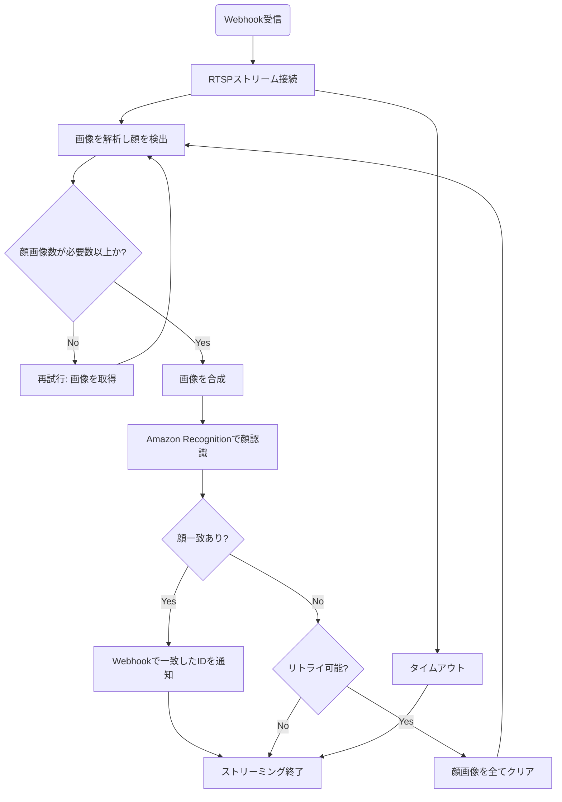

# RTSP Face Recognition

[](LICENSE)


## 概要

RTSPストリームから画像を取得して顔認識し、Webhookで結果を通知するアプリケーションです。

## フローチャート



- AWSのコストを抑えるためにFace Detectorを使ってローカルでざっくり検出させています
- 閾値未満と顔見検出はストリーミング開始直後の荒い画像が原因の可能性が高いのでリトライしています

## 使い方

### 設定

`.env` に `RTSP_URL`（RTSP/RTSPS URL）と `WEBHOOK` を設定します。RTSP映像はFFmpegでJPEGフレームへ変換します（Dockerイメージには同梱済みです）。外部から起動する受信用エンドポイントは `POST /trigger` です。リクエストを受け付けるとすぐ `202 Accepted` を返し、指定したストリームから画像を取得して認識処理を開始します。

### Native

```sh
npm install
npm run build
node --env-file=.env dist/index
```

### Docker

```sh
# --net=hostの方が安定する
docker run -d \
  --net=host \
  --name rtsp-face-recognition \
  -p 3000:3000 \
  --env-file .env \
  --restart always \
  ghcr.io/nana4rider/rtsp-face-recognition:latest
```

必要な環境変数については[こちら](src/env.ts)をご確認ください。

## リンク

- [Face Detector](https://github.com/nana4rider/face-detector)
- [Amazon Rekognition API SearchFacesByImageCommand](https://docs.aws.amazon.com/AWSJavaScriptSDK/v3/latest/client/rekognition/command/SearchFacesByImageCommand/)

## ドキュメント

- [API Document](https://nana4rider.github.io/openapi-ui/?rtsp-face-recognition)
